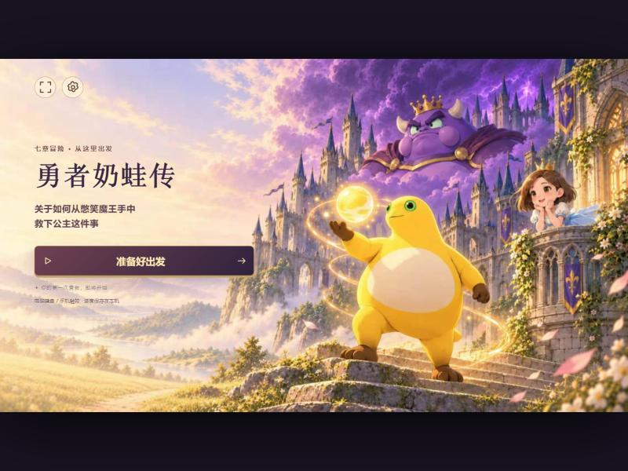

# 勇者奶蛙传 · 本地离线版

> 把 H5 小游戏《勇者奶蛙传：关于如何从憋笑魔王手中救下公主这件事》完整镜像到本地，
> 双击即玩、全程离线，并移除了死亡后的激励视频广告。

<p align="center">
  
</p>

<p align="center">
  
  
  
  
</p>

---

## 🐸 游戏简介

《勇者奶蛙传》是一款横版动作闯关小游戏。憋笑魔王封锁了整座城堡的笑声，还掳走了豆公主，奶蛙勇者只好揣着一肚子奶球、带着一张憋不住笑的脸，从村口一路打进王座——用肚皮冲撞、用大笑清场，把魔王笑到破防。

- **七章战役**：奶笑村 → 咕嘎小径 → 刀盾山道 → 风暴断桥 → 禁声堡垒 → 肃静大殿 → 无声王座。
- **每章数波敌潮 + 守关 BOSS**：凑企鹅、刀盾狗、铁桶队长、裂甲将军、缄默大将军，终局直面两阶段形态的憋笑魔王。
- **战斗手段**：奶球连射（`F`）、防御减伤（`Space`）、攒满释放的捧腹大笑（`E`）、通关奶笑村后解锁的肚皮冲撞（`Shift`）、回满血的黄桃罐头（`C`）、召唤奶蛋助阵（`V`）；决战中豆公主赐下庇护，可讲笑话蓄力放出超级大笑（`Q`）。
- **关卡内成长**：每过一关三选一强化——自动奶球、哈哈三连、笑穿全场、护体锅盖、肚皮地震、笑到地动山摇……
- **计时挑战**：记录营救用时与击倒数，按成绩授予「城堡拆迁勇者」等称号，可生成战绩图分享。
- **双端操作**：键盘走位放技能，手机用虚拟摇杆 + 技能按钮，支持横屏与全屏。

> 原站标语：奶蛙勇闯憋笑城堡，肚皮冲撞、大笑清场！闯过七关救出豆公主。免下载，手机电脑都能玩。

## ✨ 特性

- **完整离线**：92 个文件 / 约 30 MB，HTML、JS、CSS、74 张 WebP、8 段音频、结局动画全部落地，无任何 CDN 依赖。
- **一键启动**：双击 `启动游戏.bat`，自动起本地服务并打开浏览器。
- **免广告复活**：死亡后点一次「重闯本关」直接回到本区域入口，不请求任何广告 SDK。
- **零第三方依赖**：启动器只用 Python 标准库。
- **进度本地保存**：章节进度、设置、最佳纪录存在浏览器 localStorage。
- **原样镜像**：资源目录结构与线上一致，可随时与源站对照。

## 🚀 快速开始

### Windows（推荐）

双击 **`启动游戏.bat`**。

浏览器会自动打开 `http://127.0.0.1:8123/`；**关掉命令行窗口即停止服务**。
8123 被占用时会自动改用随机端口，命令行窗口里会打印实际地址。

### 手动启动（任意平台）

```bash
python3 serve.py
```

### 为什么不直接双击 `index.html`

1. 页面用 `<script type="module">` 加载，`file://` 协议下浏览器会以 CORS 为由拒绝执行；
2. 游戏用 CacheStorage 缓存图片并按 sha256 校验，该 API 在 `file://` 下不可用。

因此必须通过 `http://127.0.0.1` 访问。`serve.py` 只做这一件事，不做任何联网行为。

## 🎮 操作

| 按键 | 动作 | 按键 | 动作 |
|---|---|---|---|
| `W` `A` `S` `D` | 走动 | `F` | 奶球（按住连发） |
| `Space` | 防御（按住） | `E` | 捧腹大笑 |
| `Q` | 超级大笑（蓄满） | `Shift` | 肚皮冲撞 |
| `R` | 快速点击 | `V` | 召唤奶蛋 |
| `C` | 黄桃罐头（回血） | — | 手机端支持触控按键布局 |

## 🩹 相对线上的本地改动

只改了一个文件：`site/assets/main-BsKo9vWW.js`（Vite 打包后的主逻辑，未混淆）。

| 位置 | 线上行为 | 本地行为 |
|---|---|---|
| `Pa()` 复活处理 | 调 `_.present()` 拉起激励视频，看完才解锁，需要点两次 | 跳过广告，直接执行原「广告完成」分支，点一次即复活 |
| 复活按钮文案 | 看完广告再闯一次 | 重闯本关 |
| 死亡页提示 | 观看完成后，再点击按钮重闯本关。 | 点击按钮，从本区域入口重闯。 |

战斗、存档、音效、关卡逻辑均未改动。

## 📁 目录结构

```
.
├── site/                    # 镜像站点（保持原始相对路径，勿单独移动内部文件）
│   ├── index.html
│   ├── manifest.json
│   ├── favicon.svg
│   └── assets/
│       ├── game-*.js        # 入口（动态加载主包与 Phaser）
│       ├── main-*.js        # 游戏主逻辑
│       ├── phaser-*.js      # Phaser 3.90 引擎
│       ├── main-*.css
│       ├── audio/           # 8 段 BGM / 音效
│       ├── backgrounds/     # 7 个场景背景
│       ├── characters/      # 角色立绘、描边、Boss 形态
│       ├── cinematics/      # 结局动画
│       └── items/
├── serve.py                 # 本地静态服务（自动选端口 + 打开浏览器）
├── 启动游戏.bat             # Windows 双击启动
└── docs/preview.jpg
```

## ⚙️ 实现说明

- **抓取方式**：解析入口 `index.html` 的 Vite 产物，递归提取 `game-*.js`、`main-*.js`、`phaser-*.js`、CSS `url()`，以及主逻辑中全部 84 条 `./assets/...` 引用（含模板字符串拼出的路径，如 `./assets/characters/${skin}-idle.webp`），逐条下载并核对状态码与文件大小。
- **完整性**：源站自带 `path → sha256` 映射表用于缓存校验，所有键均能在本地找到对应文件。
- **端口探测**：不使用 `SO_REUSEADDR`。Windows 上它允许绑定到已被监听的端口，会造成两个服务抢占同一端口、部分资源 404 的隐蔽故障。
- **MIME 补全**：为 `.webp` `.m4a` `.ogg` 等补齐 `Content-Type`，避免浏览器用错解码器。
- **不缓存**：本地服务返回 `Cache-Control: no-store`，改动文件刷新即生效。

## ⚠️ 已知限制

- 仅镜像了 `1.0.2` 这一版本的**构建产物**，不是原始工程源码；无法通过本仓库修改上游逻辑以外的东西。
- 进度保存在浏览器 localStorage，换浏览器或清缓存即丢失。
- 结局动画为 20 MB 的 MP4，首次播放会有短暂加载。
- 已在 Windows 10 19045 + Chrome 验证；其他浏览器未逐项测试。

## 📜 免责声明

本仓库中的游戏代码、美术、音乐、动画等**全部版权归原作者及发行方所有**。
本项目仅作为个人离线备份与技术研究用途，**不提供任何授权**，请勿用于商业用途、二次分发或任何侵权场景。
若权利人认为内容不妥，请开 issue 联系删除。
